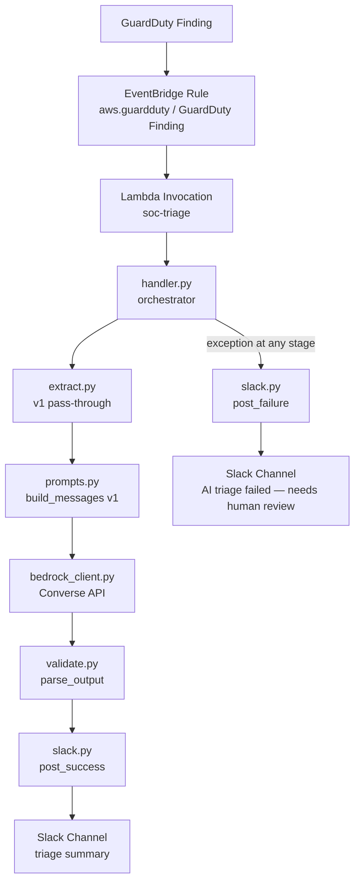
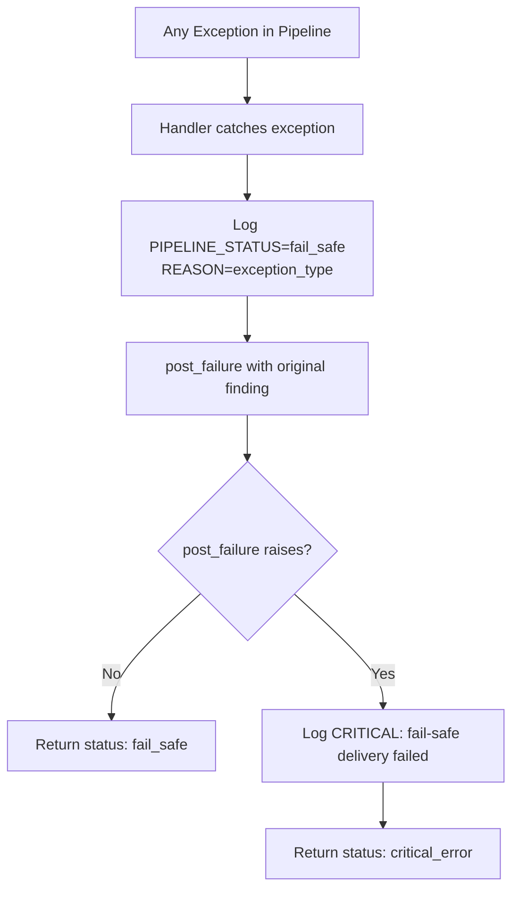
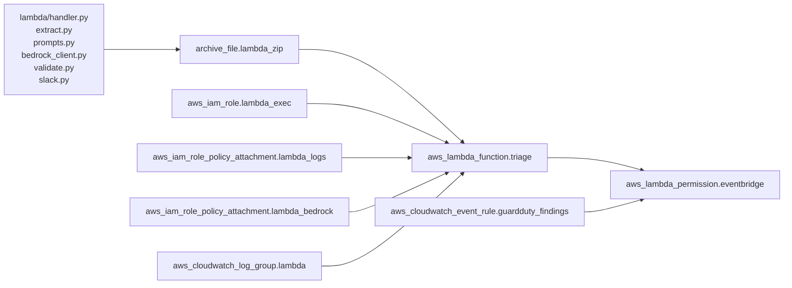

# Design Document

## Overview

This document describes the technical design for Phases 5 and 6 of the SOC Triage Guardrails project: wiring the existing Lambda stub to Amazon Bedrock (Converse API, Claude Haiku 4.5 via cross-region inference profile) and posting the AI-generated triage summary to a Slack channel via an Incoming Webhook.

The implementation is the **v1 deliberately naive** pipeline. No field allowlisting, no Bedrock Guardrail, and no strict output-schema enforcement are applied at this stage — by design, so that the prompt-injection vulnerability can be demonstrated in Phase 8 before v2 hardens it. Every module is structured so that v2 layers on top without rewriting v1.

The fail-safe principle underpins every design decision: if anything goes wrong at any stage, the raw GuardDuty finding is escalated to Slack with a "needs human review" flag. No alert is ever silently dropped.

---

## Architecture

### End-to-End Flow



### Fail-Safe Path



### Terraform Resource Dependencies



### Slack Webhook Secret Flow

```
TF_VAR_slack_webhook_url (shell env, never committed)
        ↓
variables.tf — sensitive = true variable "slack_webhook_url"
        ↓
aws_lambda_function.triage — environment { SLACK_WEBHOOK_URL = var.slack_webhook_url }
        ↓
Lambda runtime — os.environ["SLACK_WEBHOOK_URL"]
        ↓
slack.py — urllib.request.urlopen POST to webhook URL
```

The URL never appears in source code, Terraform state output attributes, test fixtures, or git history. `terraform.tfstate` and `*.tfvars` are covered by `.gitignore`.

---

## Components and Interfaces

### handler.py

Entry point. Orchestrates the pipeline and owns all error handling.

```python
def lambda_handler(event: dict, context: object) -> dict
```

**Responsibilities:**
- Read `event["detail"]` as the GuardDuty finding.
- Log `RAW_FINDING_TYPE=<finding["type"]>` at INFO before any processing.
- Read and validate the `PROMPT_VERSION` environment variable; raise `ValueError` if absent or empty (this triggers the fail-safe).
- Log `PROMPT_VERSION=<value>` at INFO.
- Call the five modules in order: `extract_fields` → `build_messages` → `triage` → `parse_output` → `post_success`.
- On success: log `PIPELINE_STATUS=ok`, return `{"status": "ok"}`.
- On any exception from the pipeline: log `PIPELINE_STATUS=fail_safe REASON=<ExceptionType>` at ERROR, call `post_failure(finding, exc)`.
  - If `post_failure` succeeds: return `{"status": "fail_safe"}`.
  - If `post_failure` also raises: log `PIPELINE_STATUS=critical_error` at CRITICAL, return `{"status": "critical_error"}` (never re-raise).

**Try/except structure:**

```python
def lambda_handler(event, context):
    finding = event["detail"]
    log.info("RAW_FINDING_TYPE=%s", finding.get("type"))

    prompt_version = os.environ.get("PROMPT_VERSION", "")
    if not prompt_version:
        exc = ValueError("PROMPT_VERSION env var is absent or empty")
        return _fail_safe(finding, exc)
    log.info("PROMPT_VERSION=%s", prompt_version)

    try:
        fields  = extract_fields(finding)
        system, messages = build_messages(fields, prompt_version)
        raw_text = triage(system, messages)
        parsed   = parse_output(raw_text)
        post_success(parsed, finding)
        log.info("PIPELINE_STATUS=ok")
        return {"status": "ok"}
    except Exception as exc:
        return _fail_safe(finding, exc)

def _fail_safe(finding, exc):
    log.error("PIPELINE_STATUS=fail_safe REASON=%s", type(exc).__name__)
    try:
        post_failure(finding, exc)
        return {"status": "fail_safe"}
    except Exception as inner:
        log.critical("PIPELINE_STATUS=critical_error REASON=%s", type(inner).__name__)
        return {"status": "critical_error"}
```

---

### extract.py

Prepares the finding for the prompt. In v1 this is a pass-through; in v2 it will become the allowlist/sanitize layer.

```python
def extract_fields(finding: dict) -> dict
```

**Returns:**
```python
{
    "finding_json":     finding,            # original dict
    "finding_json_str": json.dumps(finding) # serialized for prompt injection into messages
}
```

**Validation:**
- If `finding` is not a `dict`, or is an empty `dict`, raise `ValueError("extract_fields requires a non-empty dict")`.
- Let `json.dumps` exceptions (`TypeError`) propagate unchanged — the handler's `except Exception` block will catch them and trigger the fail-safe.

**Logging:**
- `log.debug("EXTRACT_VERSION=v1")` — lets future traces distinguish v1 from v2 extraction behavior.

---

### prompts.py

Owns the prompt constants and the message-list builder.

**Module-level constants:**

```python
PROMPT_VERSION: str = "v1"

PROMPT_V1: str = """You are a SOC analyst. Analyze the GuardDuty finding below.
Return ONLY valid JSON with no prose, no markdown fences, and no keys outside this schema:

{
  "summary": "<plain-English explanation, 2-3 sentences>",
  "severity": "<LOW | MEDIUM | HIGH | CRITICAL>",
  "attack_technique_id": "<MITRE ATT&CK ID, e.g. T1078>",
  "attack_technique_name": "<technique name>",
  "recommended_action": "<one concrete next step>",
  "suspicious_input_detected": false
}

Rules:
- severity must be exactly one of: LOW, MEDIUM, HIGH, CRITICAL
- attack_technique_id must match the pattern T<digits> or T<digits>.<digits>
- suspicious_input_detected must be boolean false (v1 does not detect injection)
- Return nothing outside the JSON object — no explanation, no code fence"""
```

> **Deliberate v1 omissions (documented here for the threat model):** `PROMPT_V1` contains no `<finding_data>` delimiters, no instruction to treat the finding as untrusted data, and no reference to a Bedrock Guardrail. These omissions are intentional so that Phase 8 injection payloads have a realistic attack surface.

```python
def build_messages(fields: dict, version: str) -> tuple[str, list[dict]]
```

- If `version == "v1"`: return `(PROMPT_V1, [{"role": "user", "content": fields["finding_json_str"]}])`.
- If `version` is any other string: raise `ValueError(f"Unknown prompt version: {version!r}")`.
- The messages list is the exact shape the Converse API expects under the `messages` parameter.

---

### bedrock_client.py

Isolates all Bedrock API details. Module-level client creation reuses the Lambda execution environment's connection across warm invocations.

```python
import boto3
_client = boto3.client("bedrock-runtime", region_name="us-east-1")

MODEL_ID = "us.anthropic.claude-haiku-4-5-20251001-v1:0"

def triage(system_prompt: str, messages: list[dict]) -> str
```

**Converse call shape:**

```python
response = _client.converse(
    modelId=MODEL_ID,
    system=[{"text": system_prompt}],
    messages=messages,
    inferenceConfig={"maxTokens": 600, "temperature": 0},
)
```

**Response extraction:**

```python
try:
    text = response["output"]["message"]["content"][0]["text"]
except (KeyError, IndexError) as exc:
    raise ValueError(f"Unexpected Bedrock response shape: {exc}") from exc
log.info("BEDROCK_STOP_REASON=%s", response.get("stopReason"))
return text
```

**Error propagation:** `ClientError` and `EndpointResolutionError` from boto3 propagate unchanged — the handler's `except Exception` block catches them and triggers the fail-safe.

---

### validate.py

Parses the model's text response. In v1 this is a best-effort parse; strict schema enforcement is a v2 concern.

```python
import json, re

_FENCE_PATTERN = re.compile(
    r"```(?:json)?\s*\n?(.*?)\n?\s*```", re.DOTALL | re.IGNORECASE
)

def parse_output(text: str) -> dict
```

**Logic:**

1. Attempt to strip a markdown code fence using `_FENCE_PATTERN`. If a match is found, use the captured group as the candidate string; otherwise use `text` as-is.
2. Call `json.loads(candidate)`.
3. If `json.loads` raises `json.JSONDecodeError`, raise `ValueError(f"Model output is not valid JSON: {candidate[:200]!r}")`.
4. If `json.loads` returns a type that is not `dict` (e.g., a list or scalar), raise `ValueError(f"Model output is not a JSON object: {type(result).__name__}")`.
5. Return the parsed dict.

---

### slack.py

Posts to the Slack Incoming Webhook. Uses `urllib` only — no third-party packages.

```python
import json, logging, os
from urllib import request as urlrequest
from urllib.error import HTTPError

log = logging.getLogger()

def post_success(triage: dict, finding: dict) -> None
def post_failure(finding: dict, exc: Exception) -> None
```

**`post_success` logic:**

1. Read `SLACK_WEBHOOK_URL` from env; raise `ValueError("SLACK_WEBHOOK_URL is not configured")` if absent or empty — before any HTTP request.
2. Assert all required fields are present in `triage`: `summary`, `severity`, `attack_technique_id`, `attack_technique_name`, `recommended_action`. Raise `KeyError(f"Missing required triage field: {field}")` for the first missing field — before any HTTP request.
3. Build the message body:

```python
body = {
    "text": (
        f"*GuardDuty Finding: {finding.get('type', 'Unknown')}*\n"
        f"*Severity:* {triage['severity']}\n"
        f"*Summary:* {triage['summary'][:500]}\n"
        f"*ATT&CK:* {triage['attack_technique_id']} — {triage['attack_technique_name']}\n"
        f"*Action:* {triage['recommended_action']}"
    )
}
```

4. POST via `urllib.request.urlopen` with `Content-Type: application/json`, 10-second timeout, UTF-8-encoded body.
5. If HTTP status ≠ 200: log `SLACK_STATUS=<code>` at ERROR and raise `IOError(f"Slack webhook returned {code}")`.

**`post_failure` logic:**

1. Same env var check as above.
2. Build the escalation body:

```python
body = {
    "text": (
        f":rotating_light: *AI triage failed — needs human review*\n"
        f"*Finding:* {finding.get('title', 'N/A')}\n"
        f"*Type:* {finding.get('type', 'N/A')}\n"
        f"*GuardDuty Severity:* {finding.get('severity', 'N/A')}\n"
        f"*Finding ID:* {finding.get('id', 'N/A')}\n"
        f"*Error:* {type(exc).__name__}"
    )
}
```

3. Same POST logic (timeout 10s, Content-Type header, non-200 → IOError).

---

## Data Models

### GuardDuty Finding (subset used by v1)

The full event is passed through in v1. The handler reads `event["detail"]` as the finding dict. Fields used in the Slack messages are:

| Field | Type | Used by |
|---|---|---|
| `type` | `str` | handler log, slack.py success + failure |
| `severity` | `float` (GuardDuty) | slack.py failure |
| `title` | `str` | slack.py failure |
| `id` | `str` | slack.py failure |

All fields are passed to `extract_fields` which returns the full dict for `finding_json` and its JSON serialization for `finding_json_str`.

### Output Contract (JSON schema the model must return)

| Field | Type | Allowed values |
|---|---|---|
| `summary` | `string` | 2–3 plain-English sentences |
| `severity` | `string` | `"LOW"`, `"MEDIUM"`, `"HIGH"`, `"CRITICAL"` |
| `attack_technique_id` | `string` | Matches `^T\d{4}(\.\d{3})?$` |
| `attack_technique_name` | `string` | Non-empty string |
| `recommended_action` | `string` | Non-empty string |
| `suspicious_input_detected` | `boolean` | `false` in v1 |

> **v1 note:** `validate.py` in v1 only checks that the response is a JSON dict. The field-level schema enforcement above (regex, enum values) is a v2 concern.

### Terraform Changes Summary

| Resource | File | Change |
|---|---|---|
| `aws_iam_policy.lambda_bedrock` (new) | `iam.tf` | Adds `bedrock:InvokeModel` on 4 ARNs (inference profile + 3 foundation-model ARNs across us-east-1, us-east-2, us-west-2) |
| `aws_iam_role_policy_attachment.lambda_bedrock` (new) | `iam.tf` | Attaches Bedrock policy to role |
| `aws_lambda_function.triage` | `main.tf` | Adds `timeout=30`, `memory_size=256`, `environment.SLACK_WEBHOOK_URL`, `environment.PROMPT_VERSION="v1"`, updates `archive_file` source to `source_dir`, output path to `terraform/build/lambda.zip` |
| `variable "slack_webhook_url"` (new) | `variables.tf` | `sensitive=true`, validation, no default |
| `.gitignore` | `.gitignore` | Adds `*.tfvars`, `*.tfvars.json`, `terraform.tfstate`, `terraform.tfstate.backup`, `terraform/build/` |

---

## Correctness Properties

*A property is a characteristic or behavior that should hold true across all valid executions of a system — essentially, a formal statement about what the system should do. Properties serve as the bridge between human-readable specifications and machine-verifiable correctness guarantees.*

This feature is suitable for property-based testing. The Lambda modules are pure or near-pure functions (extract, prompts, validate, slack formatting logic) with clear input/output behavior over a large input space. PBT will be used with [Hypothesis](https://hypothesis.readthedocs.io/) (Python), configured to run a minimum of 100 examples per property.

---

### Property 1: Fail-safe is always triggered on pipeline exceptions

*For any* GuardDuty finding dict and any exception raised by any pipeline stage (extract, prompts, bedrock_client, validate, or slack.post_success), the handler SHALL always call `post_failure` and SHALL never propagate an unhandled exception to the Lambda runtime — the return value is always a dict.

**Validates: Requirements 1.3, 7.1, 7.5**

---

### Property 2: extract_fields rejects all invalid inputs

*For any* value that is not a non-empty dict (including non-dict types such as strings, integers, lists, and None, as well as the empty dict `{}`), `extract_fields` SHALL always raise `ValueError`.

**Validates: Requirements 2.2**

---

### Property 3: extract_fields output is a JSON round-trip of the input

*For any* non-empty dict `d`, `extract_fields(d)` SHALL return a dict where `result["finding_json"]` equals `d` and `json.loads(result["finding_json_str"])` equals `d`.

**Validates: Requirements 2.1**

---

### Property 4: build_messages always raises ValueError for unrecognized versions

*For any* string that is not a recognized prompt version (i.e., not `"v1"`), `build_messages(fields, version)` SHALL always raise `ValueError`.

**Validates: Requirements 3.6**

---

### Property 5: build_messages v1 output shape is independent of finding content

*For any* dict with a non-empty `finding_json_str` value, `build_messages(fields, "v1")` SHALL return a tuple whose first element is `PROMPT_V1` and whose second element is a list containing exactly one dict with `role="user"` and `content` equal to `fields["finding_json_str"]`.

**Validates: Requirements 3.3**

---

### Property 6: parse_output is a left-inverse of json.dumps for any dict

*For any* dict `d`, `parse_output(json.dumps(d))` SHALL return a dict equal to `d`. Additionally, `parse_output("```json\n" + json.dumps(d) + "\n```")` SHALL also return a dict equal to `d` (markdown fence stripping).

**Validates: Requirements 5.1, 5.2**

---

### Property 7: parse_output never returns a non-dict

*For any* string that is either not valid JSON or valid JSON that does not decode to a dict (arrays, scalars, null), `parse_output` SHALL raise `ValueError`.

**Validates: Requirements 5.3, 5.4**

---

### Property 8: post_success message always contains all required triage fields

*For any* triage dict containing all 6 output-contract fields and any finding dict, the JSON payload POSTed by `post_success` to the Slack webhook SHALL contain the finding type, AI summary (truncated to 500 chars), ATT&CK technique ID, ATT&CK technique name, severity, and recommended action.

**Validates: Requirements 6.2**

---

### Property 9: post_success raises KeyError for any dict missing a required field

*For any* triage dict that is missing at least one of the required fields (`summary`, `severity`, `attack_technique_id`, `attack_technique_name`, `recommended_action`), `post_success` SHALL raise `KeyError` without making any HTTP request.

**Validates: Requirements 6.8**

---

### Property 10: post_failure message always contains finding metadata and escalation text

*For any* finding dict with `title`, `type`, `severity`, and `id` fields, and any exception, the payload POSTed by `post_failure` SHALL contain the finding title, type, GuardDuty severity, finding ID, and the string `"AI triage failed"`.

**Validates: Requirements 6.4**

---

## Error Handling

| Failure mode | Where caught | Behaviour |
|---|---|---|
| `PROMPT_VERSION` absent/empty | `handler.py`, before try/except | Constructs `ValueError`, calls `_fail_safe` directly |
| `extract_fields` raises `ValueError` | `handler.py` `except Exception` | Fail-safe path → `post_failure` |
| `json.dumps` raises `TypeError` in extract | `handler.py` `except Exception` | Fail-safe path |
| `build_messages` raises `ValueError` (bad version) | `handler.py` `except Exception` | Fail-safe path |
| Bedrock `ClientError` / `EndpointResolutionError` | Re-raised by `bedrock_client.py`, caught in `handler.py` | Fail-safe path |
| Bedrock response malformed (`KeyError`/`IndexError`) | `bedrock_client.py` re-raises as `ValueError` | Fail-safe path |
| `parse_output` raises `ValueError` | `handler.py` `except Exception` | Fail-safe path |
| `post_success` raises `IOError` (non-200 Slack) | `handler.py` `except Exception` | Fail-safe path |
| `post_success` raises `KeyError` (missing field) | `handler.py` `except Exception` | Fail-safe path |
| `post_failure` raises any exception | Inner try/except in `handler.py` `_fail_safe` | Log CRITICAL, return `{"status": "critical_error"}` |

**Fail-safe guarantee:** the handler never raises to the Lambda runtime. Every code path ends in a `return` statement.

---

## Testing Strategy

### Dual Testing Approach

Unit tests cover specific examples, edge cases, and the error-propagation paths. Property-based tests (Hypothesis) cover universal behavioral guarantees across the full input space.

### Property-Based Tests

Library: [Hypothesis](https://hypothesis.readthedocs.io/) (`pip install hypothesis`), minimum 100 examples per property (`@settings(max_examples=100)`).

Each property test is tagged with a comment in the format:

```
# Feature: bedrock-triage-slack, Property <N>: <property_text>
```

| Design Property | Module | Hypothesis strategy |
|---|---|---|
| 1: Fail-safe always triggered | `handler.py` | `st.dictionaries(...)` for finding, mock stage to raise `st.from_type(Exception)` |
| 2: extract rejects invalid inputs | `extract.py` | `st.one_of(st.none(), st.integers(), st.text(), st.lists(...), st.just({}))` |
| 3: extract round-trip | `extract.py` | `st.dictionaries(st.text(), st.text())` (JSON-serializable dicts) |
| 4: build_messages rejects unknown versions | `prompts.py` | `st.text().filter(lambda s: s not in {"v1"})` |
| 5: build_messages v1 output shape | `prompts.py` | `st.text(min_size=1)` for `finding_json_str` |
| 6: parse_output round-trip | `validate.py` | `st.dictionaries(st.text(), st.text())` |
| 7: parse_output never returns non-dict | `validate.py` | `st.one_of(st.lists(...), st.integers(), st.text().filter(...))` |
| 8: post_success message completeness | `slack.py` | `st.fixed_dictionaries(...)` with all 6 contract fields |
| 9: post_success rejects missing fields | `slack.py` | Dicts with one or more required fields removed |
| 10: post_failure message completeness | `slack.py` | `st.fixed_dictionaries(...)` with finding metadata fields |

### Unit Tests (`tests/test_unit.py`)

Run with `python -m pytest tests/test_unit.py`. No AWS credentials or network access required — all boto3 and urllib calls are mocked with `unittest.mock.patch`.

**Coverage targets (minimum one test per):**

| Test | What it covers |
|---|---|
| `test_extract_passthrough` | `extract_fields` with a valid finding |
| `test_extract_invalid_inputs` | Non-dict and empty-dict → `ValueError` |
| `test_build_messages_v1_shape` | Return shape, PROMPT_V1 in system, finding_json_str in content |
| `test_build_messages_unknown_version` | `ValueError` with version string in message |
| `test_triage_happy_path` | Mock converse returns text; `triage` returns it |
| `test_triage_propagates_client_error` | boto3 `ClientError` propagates |
| `test_parse_output_plain_json` | Valid JSON dict string → dict |
| `test_parse_output_fence_stripping` | Markdown-fenced JSON → dict |
| `test_parse_output_invalid_json` | Non-JSON string → `ValueError` |
| `test_parse_output_non_dict` | JSON array → `ValueError` |
| `test_post_success_posts_correct_fields` | Mock urlopen; assert payload contains all 5 required fields |
| `test_post_success_missing_field` | Missing `severity` → `KeyError`, urlopen not called |
| `test_post_failure_contains_escalation_text` | Payload contains "AI triage failed" |
| `test_handler_ok_path` | All modules mocked to succeed → `{"status": "ok"}` |
| `test_handler_bedrock_error_triggers_fail_safe` | `ClientError` in bedrock → `{"status": "fail_safe"}` |
| `test_handler_missing_prompt_version` | No env var → `{"status": "fail_safe"}` |
| `test_handler_critical_error` | `post_failure` also raises → `{"status": "critical_error"}` |

### IAM / Terraform Checks (CI)

- `terraform fmt -check` and `terraform validate` on every push.
- Optional: Checkov scan for IAM wildcard actions.
- Verify no `*` in action or resource fields of the Bedrock policy (grep in CI).

---

## Design Check

1. **Why does the Bedrock IAM policy need four ARNs instead of one?** The `modelId` passed to the Converse API is the inference-profile ARN (`us.anthropic.claude-haiku-4-5-20251001-v1:0`). At runtime, the cross-region profile resolves to the underlying foundation-model ARN in us-east-1, us-east-2, or us-west-2. IAM is evaluated at the point of the actual model invocation, so the role must also have `bedrock:InvokeModel` on all three underlying foundation-model ARNs or the call will be denied. The inference-profile ARN permission alone is not sufficient.

2. **What specific behavior proves that the v1 prompt is vulnerable to injection?** The `PROMPT_V1` system prompt puts the raw finding JSON directly into the user message with no delimiters and no instruction to treat it as untrusted data. A payload planted in an attacker-controlled field (e.g., `userName`, a resource tag) is syntactically indistinguishable from the model's own instructions. If the model follows the injected directive — for example, returning `severity: LOW` for a HIGH-severity finding — v1 has been exploited. The test in Phase 8 runs each injection fixture 3–5 times and records the success rate.

3. **Why does the handler return `{"status": "critical_error"}` instead of raising when `post_failure` also fails?** Lambda propagating an unhandled exception causes the runtime to mark the invocation as an error, but it does not prevent future invocations. The risk here is subtler: EventBridge has a retry policy, and an unhandled exception could cause the same finding to be reprocessed multiple times. More importantly, the project's fail-safe principle states that no alert should ever be silently dropped — returning a structured dict with a `critical_error` status allows CloudWatch Logs and Lambda error metrics to surface the failure visibly, so a human can investigate, without crashing the runtime in an uncontrolled way.
